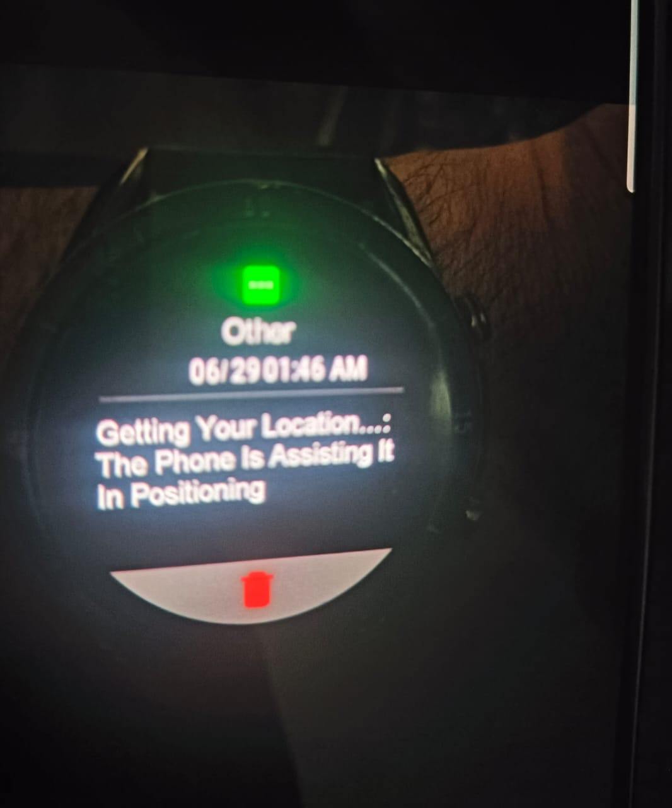
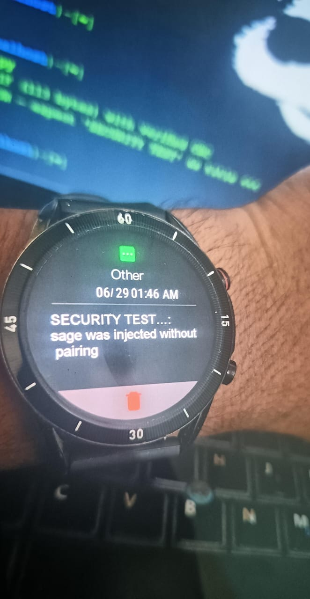
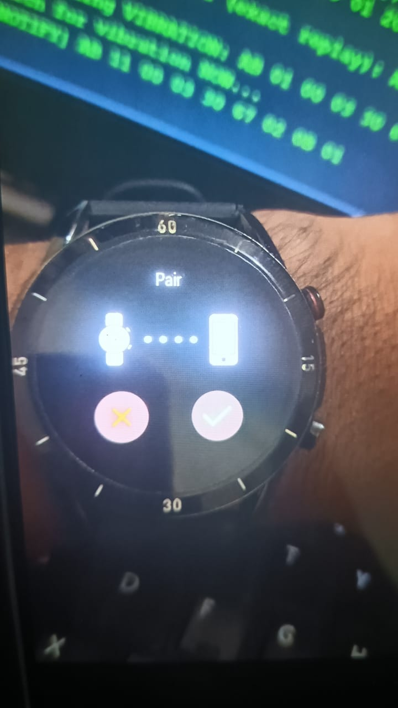
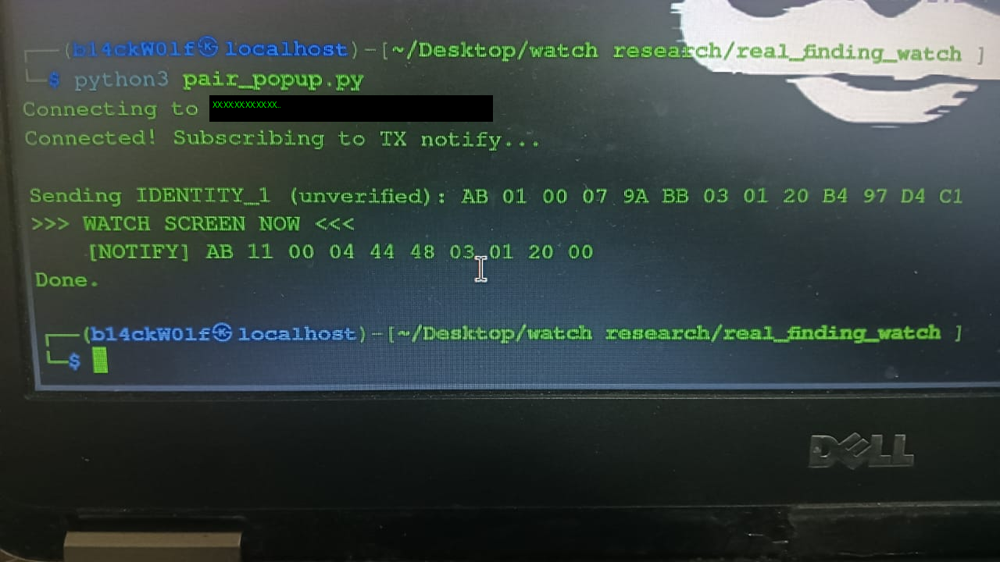
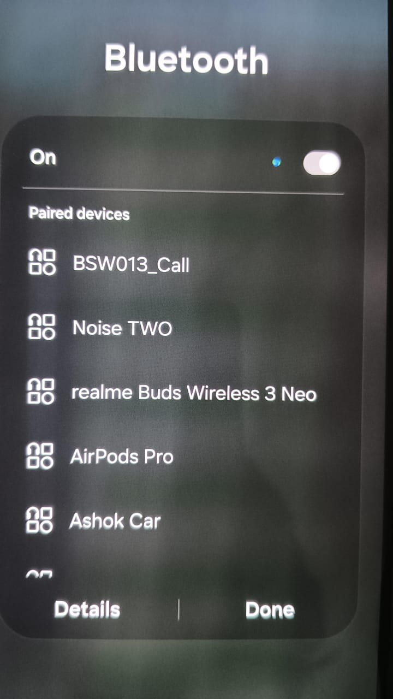
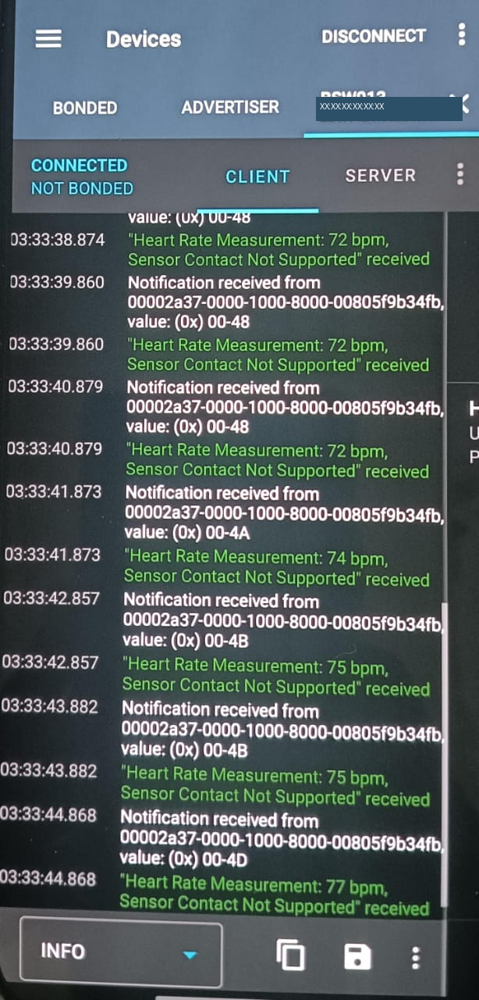

Security Advisory: Unauthenticated BLE Command Injection in Fire-Boltt BSW013 Smartwatch

**Researcher:** Pratham A Gowda (b14ckW0lf) 
**Date:** August 2026  
**Status:** Vendor notified  
**Affected Product:** Fire-Boltt BSW013 Smartwatch, Firmware V0.0.8

---

## Table of Contents

1. [Summary](#1-summary)
2. [Affected Product Details](#2-affected-product-details)
3. [Vulnerability Classification](#3-vulnerability-classification)
4. [Technical Background](#4-technical-background)
5. [Proof of Concept](#5-proof-of-concept)
6. [Impact](#6-impact)
7. [Remediation Recommendations](#7-remediation-recommendations)
8. [Disclosure Timeline](#8-disclosure-timeline)
9. [Researcher Notes on Scope and Limitations](#9-researcher-notes-on-scope-and-limitations)
10. [Photographic Evidence](#photographic-evidence)

---

## 1. Summary

The Fire-Boltt BSW013 smartwatch accepts Bluetooth Low Energy (BLE) GATT write commands from any device, without requiring pairing, bonding, or any form of authentication or session validation.

This allows an attacker within BLE range to:

1. **Inject arbitrary notification content** (custom title and body text) onto the watch display, accompanied by a vibration alert, with **zero interaction required** from the wearer.
2. **Trigger the watch's native pairing prompt** from an unbonded device; if the wearer accepts this prompt, the watch discloses device-identifying information — device name, Bluetooth MAC address, chipset vendor, model string, and a secondary hardware identifier — in **plaintext** over an unencrypted BLE notification.
3. **Subscribe to the watch's live Heart Rate Measurement characteristic** from a fully unbonded, unauthenticated device, and receive real-time BPM readings whenever the wearer has heart rate monitoring active — no pairing, bonding, or confirmation of any kind required.

All three issues stem from the same root cause:

- The watch's proprietary BLE command protocol (running over a custom GATT service resembling the Nordic UART pattern) performs no authentication.
- No session binding is enforced.
- No freshness validation is applied to incoming writes.
- The only integrity check present is a CRC-16/ARC checksum, which validates that a packet is well-formed — not that it originates from a trusted source.

## 2. Affected Product Details

| Field | Value |
|---|---|
| Device | Fire-Boltt BSW013 |
| Firmware Version | V0.0.8 |
| Bluetooth Chipset | Realtek |
| Internal Model Strings | `R9`, `R9_BSW013_FLS_NEW` |
| Companion App Package | `com.sma.smartv3.pro` |
| BLE Service (custom) | Nordic UART-style — RX `6e400002-b5a3-f393-e0a9-e50e24dcca9e`, TX `6e400003-b5a3-f393-e0a9-e50e24dcca9e` |

## 3. Vulnerability Classification

- **CWE-306**: Missing Authentication for Critical Function (primary)
- **CWE-284**: Improper Access Control
- **CWE-200**: Exposure of Sensitive Information to an Unauthorized Actor (secondary; applies to Findings B and C)

### CVSS 3.1 Vectors (self-assessed)

| Finding | Vector | Base Score |
|---|---|---|
| A — Unauthenticated Notification Injection | `AV:A/AC:L/PR:N/UI:N/S:U/C:N/I:L/A:L` | ~5.9 (Medium) |
| B — Pairing-Triggered Information Disclosure | `AV:A/AC:L/PR:N/UI:R/S:U/C:L/I:N/A:N` | ~4.2 (Medium) |
| C — Unauthenticated Heart Rate Disclosure | `AV:A/AC:L/PR:N/UI:N/S:U/C:H/I:N` | ~7.1 (High) |

Finding C is the highest severity of the three — the only finding exposing sensitive personal health data, requiring no interaction from the wearer beyond having heart rate monitoring already active.

> These are researcher self-assessments; a CNA or MITRE reviewer may adjust the final score.

## 4. Technical Background

### 4.1 Methodology

1. Enabled HCI snoop logging on an Android device paired with the target watch, capturing 49,795+ real BLE packets during normal phone-to-watch operation over an extended session.
2. Parsed the resulting btsnoop capture with a custom Python parser, decoding the HCI ACL → L2CAP → ATT protocol layers to isolate GATT Write Request/Command packets (opcodes `0x12`/`0x52`).
3. Performed entropy and structural analysis on the extracted write payloads.
4. Identified 50 unique command signatures (by cmd/key/flag byte triples) across 910 real write packets to a single GATT characteristic handle.
5. Reverse-engineered the packet checksum algorithm empirically by testing standard CRC16 variants against 25 independent real (data, checksum) pairs extracted from the capture.
6. Built and executed proof-of-concept scripts (Python, using the [`bleak`](https://github.com/hbldh/bleak) BLE library) from an independent Linux laptop with no prior pairing relationship to the watch, to test whether captured and newly-crafted commands would be accepted and acted upon.

### 4.2 Entropy and Authentication Analysis

Byte-level entropy analysis across the captured write traffic showed:

- Overall entropy: **4.223 bits** (of a possible 8) — consistent with structured, non-encrypted binary data
- Only 169 of 256 possible byte values used across the capture (66% coverage)
- **No session tokens, nonces, or message authentication codes (MACs)** identified anywhere in the capture
- Identical write payloads recur byte-for-byte at multiple points in the capture with no variation, confirming the absence of any per-message freshness mechanism (one payload recurred identically at 4 separate points in the log)

### 4.3 Protocol Structure

Reverse-engineered packet format (all multi-byte fields big-endian unless noted):

| Offset | Field | Size | Notes |
|---|---|---|---|
| 0 | Start byte | 1 | Always `0xAB` |
| 1 | Sub-header | 1 | Observed values: `0x01`, `0x11` |
| 2–3 | Length | 2 | Byte count from offset 6 to end of packet |
| 4–5 | Checksum | 2 | CRC-16/ARC (see 4.4) |
| 6 | Command | 1 | Primary command identifier |
| 7 | Key | 1 | Sub-command / parameter identifier |
| 8 | Flag | 1 | Modifier (e.g. response-expected) |
| 9+ | Payload | var | Command-specific data |

### 4.4 Checksum Algorithm (Reverse-Engineered)

- The 2-byte checksum field was empirically identified as **CRC-16/ARC** (polynomial `0x8005`, reflected input/output, init `0x0000`, no final XOR — equivalently implemented with the reflected polynomial `0xA001`).
- Computed over all bytes from the Command field (offset 6) to the end of the packet.
- Verified by testing 21 standard CRC16 variants across multiple candidate byte ranges against 25 independent real packets pulled from the capture.
- CRC-16/ARC over `packet[6:]` matched 25/25 samples exactly.

See [`poc/crc16_arc.py`](bsw013-advisory/poc/crc16_arc.py) for the reference implementation.

## 5. Proof of Concept

Full runnable scripts are in [`/poc`](bsw013-advisory/poc). All require [`bleak`](https://pypi.org/project/bleak/) (`pip install bleak`) and a target watch MAC address.

### 5.1 Finding A: Unauthenticated Arbitrary Notification Injection (No User Interaction)

**Preconditions:** Attacker device within BLE range; watch's Bluetooth MAC known (discoverable via passive BLE scan, as the device advertises).

**Steps:**
1. Attacker device opens an independent BLE GATT connection directly to the watch (no pairing/bonding performed or required).
2. Attacker crafts a command packet using command `0x04`, key `0x01`, flag `0x00` (the watch's native "location/notification" command), with the checksum computed as described in §4.4.
3. Attacker writes this packet to characteristic `6e400002-b5a3-f393-e0a9-e50e24dcca9e`.
4. **Observed result:** the watch immediately vibrates and displays the attacker-supplied title and body text as a notification, with no prompt, confirmation, or action required from the wearer.

**Verification of arbitrary content control:** a new packet was constructed from scratch with original title/body text ("SECURITY TEST" / "This message was injected without pairing"), using the reverse-engineered checksum algorithm. This packet was accepted and displayed identically to a captured/replayed one, confirming full attacker control over displayed content — not limited to previously captured messages.

Script: [`poc/finding_a_notification_injection.py`](bsw013-advisory/poc/finding_a_notification_injection.py)

See Figures 1–2 in [Photographic Evidence](#photographic-evidence).

### 5.2 Finding B: Pairing-Triggered Plaintext Information Disclosure (Requires User Interaction)

**Steps:**
1. Attacker device connects to the watch as above, with no bonding.
2. Attacker sends a command with command `0x03`, key `0x01`, flag `0x20` (identity/handshake command).
3. **Observed result:** the watch displays a native pairing confirmation prompt (Accept/Decline) to the wearer.
4. If the wearer taps **Accept**, the watch immediately transmits a plaintext data dump via BLE notification, containing:
   - Device name: `BSW013`
   - Bluetooth MAC address
   - Chipset vendor: `Realtek`
   - Model identifiers: `R9`, `R9_BSW013_FLS_NEW`
   - A secondary hardware identifier (second MAC-style identifier)

Tested and reproduced across 3 independent runs, capturing all three possible wearer responses (ignored, declined, accepted) — behavior is deterministic and reproducible.

Notably, throughout this exchange the underlying Bluetooth connection state remained **"Not Bonded"** (confirmed via nRF Connect), demonstrating that the watch's application-layer pairing dialog is disconnected from actual BLE-level bonding/authentication — the plaintext data is sent over the unbonded, unencrypted link regardless.

Script: [`poc/finding_b_pair_prompt_trigger.py`](bsw013-advisory/poc/finding_b_pair_prompt_trigger.py)

See Figures 3–4 in [Photographic Evidence](#photographic-evidence).

### 5.3 Finding C: Unauthenticated Live Heart Rate Disclosure

**Preconditions:** Attacker device within BLE range; wearer has heart rate monitoring actively running on the watch.

**Steps:**
1. Attacker device opens an independent, unbonded BLE GATT connection to the watch, as in Findings A and B.
2. Attacker subscribes to notifications on the standard Bluetooth SIG Heart Rate Measurement characteristic (`00002a37-0000-1000-8000-00805f9b34fb`) by writing the standard Client Characteristic Configuration Descriptor (`00002902-...`) enable value.
3. **Observed result:** while the wearer has heart rate monitoring active, the attacker's unbonded connection receives live heart rate notifications (standard GATT Heart Rate Measurement format: flags byte followed by BPM value), with no pairing, bonding, confirmation, or authentication of any kind.

Verified directly using nRF Connect from a connection that remained in the "Not Bonded" state throughout. No custom protocol reverse-engineering was needed — this uses the standard, publicly documented Bluetooth SIG Heart Rate Service; the vulnerability is purely the watch's failure to require bonding before permitting subscription.

Script: [`poc/finding_c_heart_rate_disclosure.py`](bsw013-advisory/poc/finding_c_heart_rate_disclosure.py)

> **Scope note:** data only streams while the wearer has heart rate monitoring actively running on the watch; it does not appear to expose a continuous passive background feed. Still a meaningful exposure, since many users leave on-demand HR monitoring running for extended periods (e.g. during exercise), during which any nearby attacker can silently read live readings.

See Figures 5–6 in [Photographic Evidence](#photographic-evidence).

## 6. Impact

- **Notification spoofing / social engineering (Finding A):** an attacker can display arbitrary, seemingly-legitimate notifications on a victim's wrist, with no interaction, from any BLE-range proximity (typically 10–30m, more with directional antennas). Could be used for harassment, spam, or crafting deceptive messages the wearer may act on.
- **Device fingerprinting / info disclosure (Finding B):** an attacker who successfully social-engineers a wearer into accepting a spoofed pairing prompt obtains identifying hardware information in plaintext, which could aid further targeted attacks or tracking.
- **Sensitive health data exposure (Finding C):** an attacker in BLE range can passively read a wearer's live heart rate data without any pairing, interaction, or awareness on the wearer's part, whenever heart rate monitoring is active. This is a privacy-sensitive exposure of personal health information, and is the most severe of the three findings.
- No evidence found of arbitrary code execution, firmware modification, or persistent compromise — this research did not extend to firmware-level analysis.

## 7. Remediation Recommendations

1. Implement BLE bonding/pairing (e.g. LE Secure Connections) as a hard requirement before accepting any GATT write to command characteristics, and before permitting subscription to sensitive characteristics such as Heart Rate Measurement.
2. Bind application-layer session state to the underlying BLE bonding state, so "paired" at the app layer cannot be achieved without genuine BLE-level authentication.
3. Add a rolling nonce, counter, or timestamp-based freshness check to command payloads, validated device-side, to prevent replay even if a valid command is captured.
4. Do not transmit device-identifying information (MAC, chipset, model) in response to an unauthenticated or newly-unbonded connection.

## 8. Disclosure Timeline

| Date | Event |
|---|---|
| 29/06/2026 | Initial BLE traffic capture performed |
| August 2026 | Protocol reverse-engineering and PoC development completed |
| August 2026 | Vendor notified via infocare@boltt.com (responsible disclosure, 90-day window requested) |
| August 2026 | Follow-up disclosure sent to vendor covering Finding C (heart rate exposure) |
| TBD | Vendor response / patch (pending) |
| TBD | Public disclosure / CVE publication (pending vendor response or window expiry) |

## 9. Researcher Notes on Scope and Limitations

- Testing was performed on a single physical device (firmware V0.0.8); behavior on other firmware versions is not confirmed.
- This research did not include firmware extraction, static/dynamic firmware analysis, or fuzzing beyond the command signatures naturally observed in captured traffic.
- Two other Fire-Boltt models (BGS001, Artillery NJ-R6E-10.3) have separately published CVEs (CVE-2026-37271, CVE-2024-46539) for related but distinct BLE authentication weaknesses, confirming this is a recurring pattern across the vendor's product line rather than an isolated incident.

## Photographic Evidence

### Finding A — Unauthenticated Notification Injection

**Figure 1.** Captured/replayed real packet triggering a notification and vibration on the watch, with zero pairing or user interaction.

**Figure 2.** Custom, non-captured packet — original text ("SECURITY TEST… message was injected without pairing") constructed from scratch using the reverse-engineered protocol and checksum, confirming arbitrary attacker-controlled content, not just replay.

### Finding B — Pairing-Triggered Information Disclosure

**Figure 3.** The watch's native Pair confirmation prompt, triggered remotely from an unbonded attacker device sending the `IDENTITY_1` command.

**Figure 4.** Terminal output of the proof-of-concept script (`pair_popup.py`) that triggered the prompt shown in Figure 3, run from an independent Linux laptop with no prior pairing relationship to the watch.

### Finding C — Unauthenticated Heart Rate Disclosure

**Figure 5.** Phone Bluetooth settings showing the watch (`BSW013_Call`) as a separately bonded device on the researcher's own phone — included to establish the test environment; this bonded phone connection is distinct from, and unrelated to, the unbonded attacker connection used to capture heart rate data below.

**Figure 6.** nRF Connect log showing a live stream of real heart rate notifications (72–77 BPM, standard Heart Rate Measurement characteristic `00002a37`) received over a connection explicitly shown as "CONNECTED / NOT BONDED" — confirming this data is readable without any pairing or authentication.

---

## License

This advisory is released for informational and defensive security purposes. See [LICENSE](bsw013-advisory/LICENSE) for terms.
